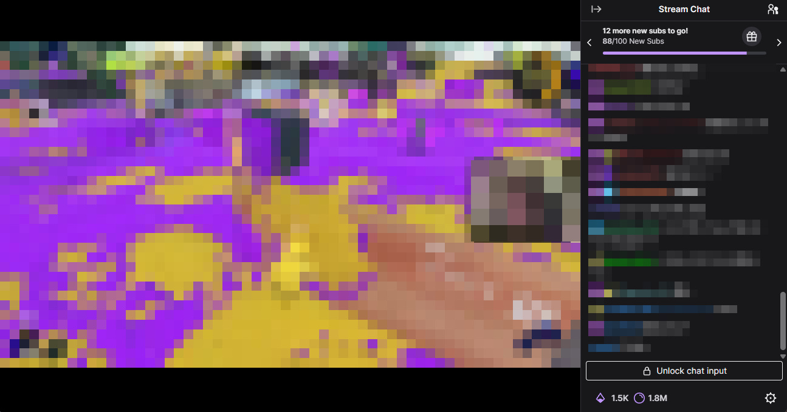
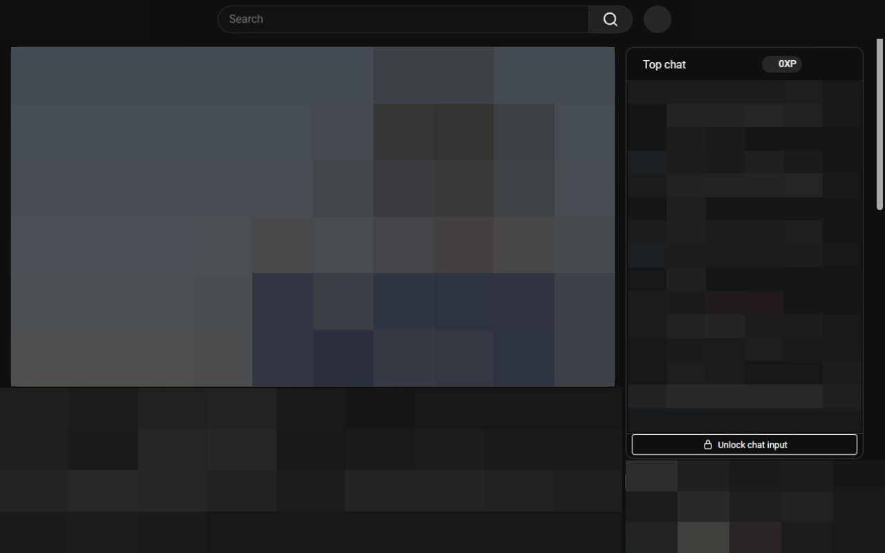
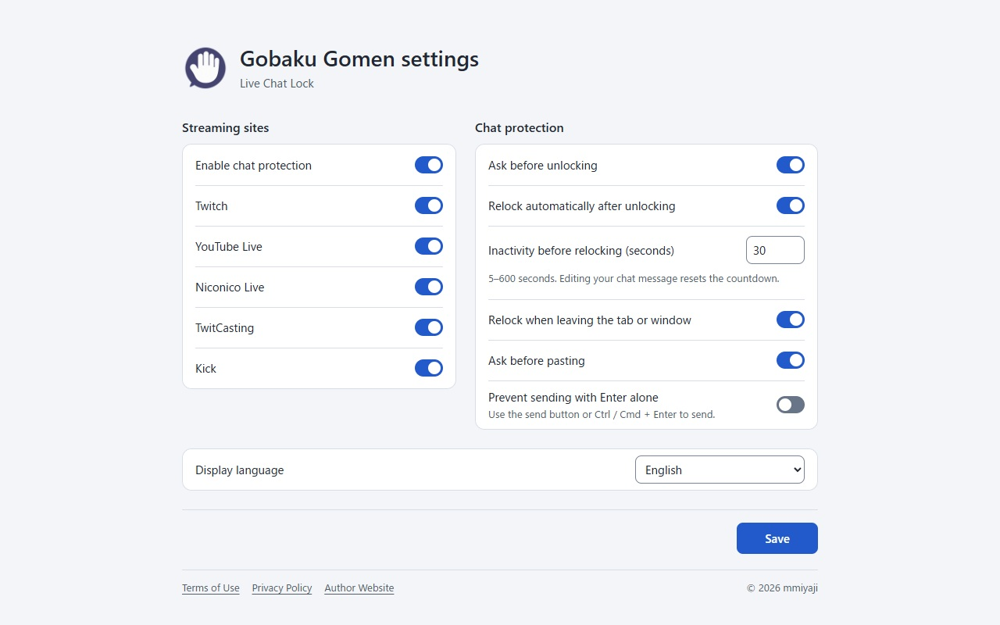

# Gobaku Gomen – Live Chat Lock

[日本語](README.md)

Gobaku Gomen is a Chrome extension that helps prevent accidental pastes and messages in livestream chat. It supports Twitch, YouTube Live, Niconico Live, TwitCasting, and Kick.

## Screenshots

The livestream video, chat messages, usernames, and service logos are masked. The Twitch screenshot shows the actual locked chat, with **Unlock chat input** visible.

| YouTube Live | Extension settings |
| --- | --- |
|  |  |

## Install from source

1. Open `chrome://extensions/` in Chrome.
2. Turn on **Developer mode**.
3. Choose **Load unpacked** and select the folder containing `manifest.json`.
4. Reload any open livestream tabs.

## Use the chat lock

1. Choose **Unlock chat input** in the chat panel. You can also focus the button with Tab and activate it with Enter or Space.
2. By default, the extension asks for confirmation, then focuses the chat input.
3. When the timer is enabled, the chat locks again after the configured period of inactivity. You can also relock it manually.

The toolbar popup turns protection on or off across all sites. Open **Advanced settings** to choose which sites to protect, set the relock timer, require confirmation before pasting, or prevent Enter alone from sending a message. You can also choose English, Japanese, or the Chrome display language.

With paste confirmation on, select **Allow next paste**, then paste again into the same field within 10 seconds. The extension does not read the clipboard. Dragging content into the chat field is blocked while paste confirmation is on.

YouTube Live works with both the chat embedded in the watch page and pop-out live chat. Chat replay is outside the supported scope.

## Terms and privacy

- [Terms of Use](https://mmiyaji.github.io/gobaku-gomen/terms.html)
- [Privacy Policy](https://mmiyaji.github.io/gobaku-gomen/privacy.html)
- [Author Website](https://ruhenheim.org/)

© 2026 mmiyaji
