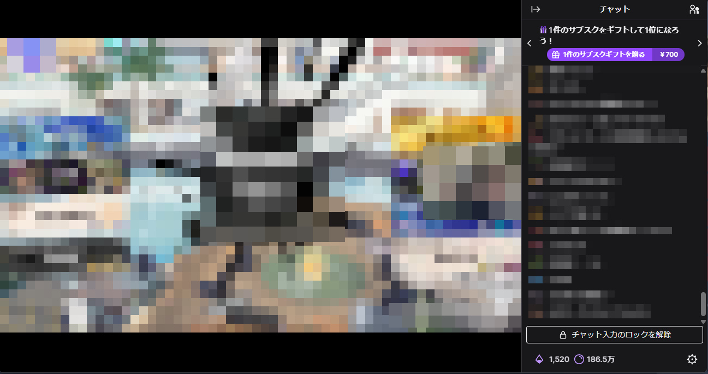
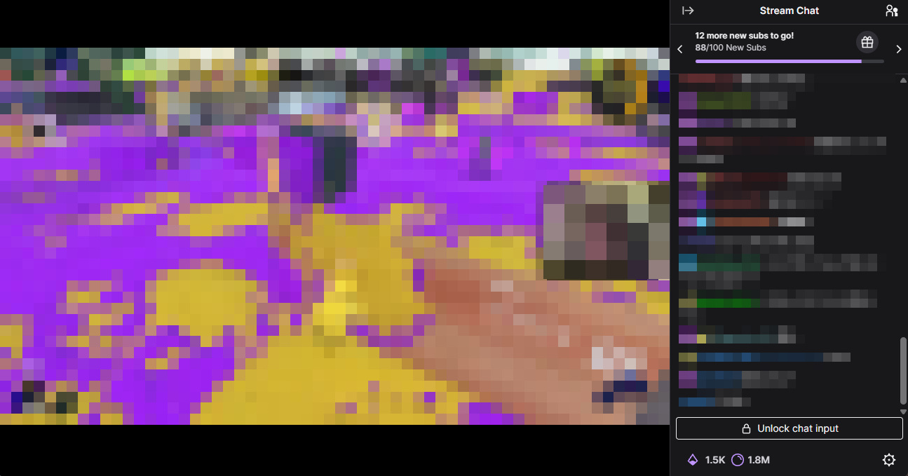
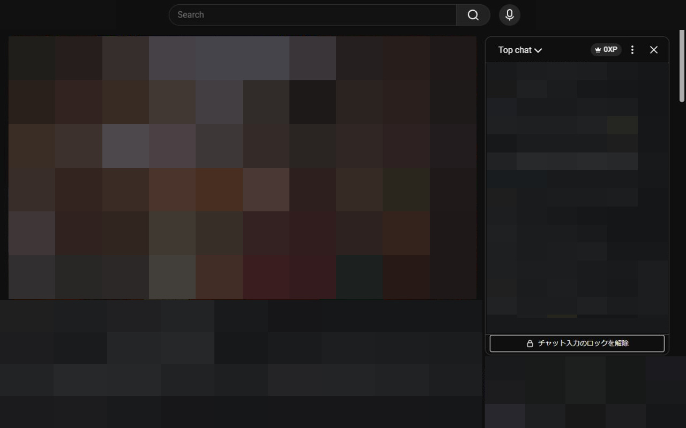
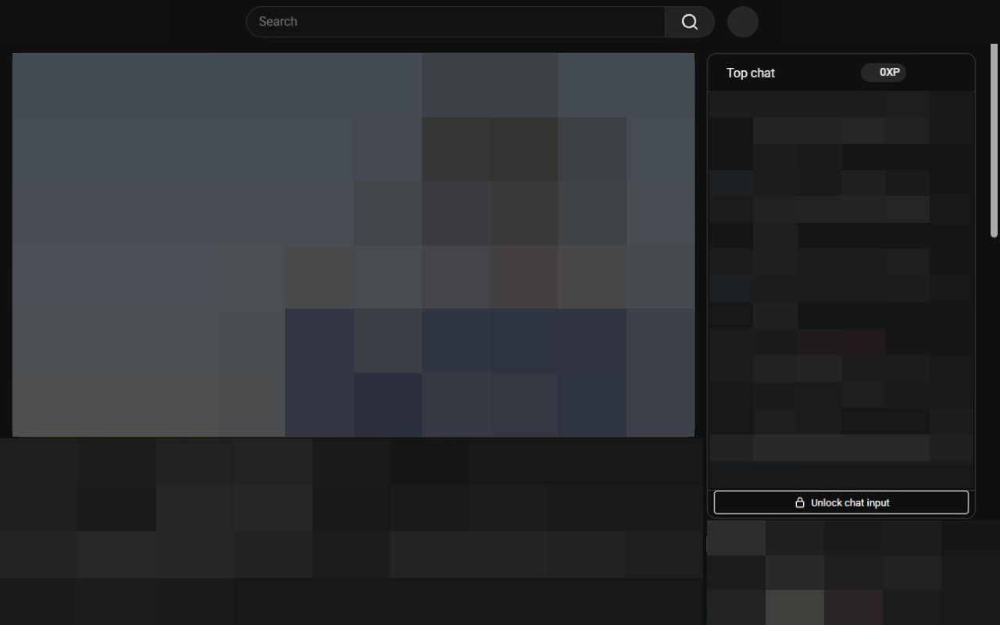
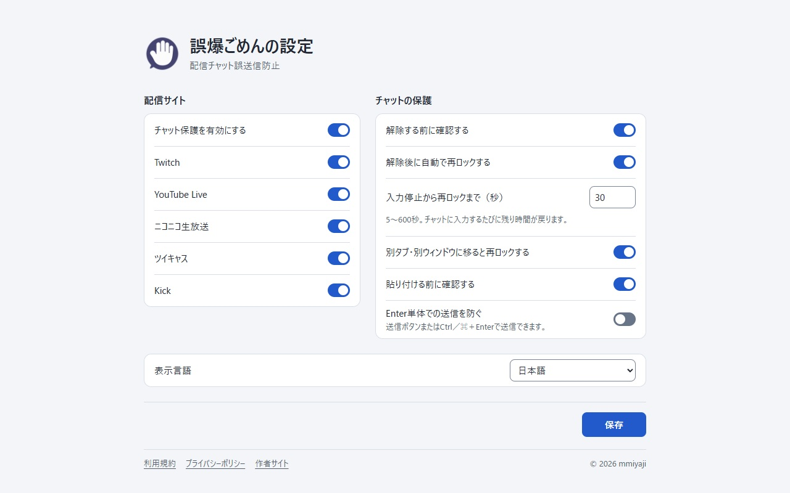
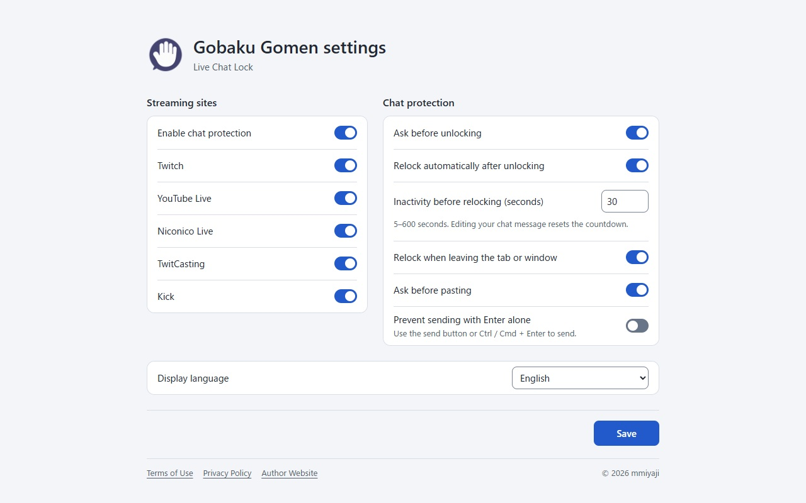

# 誤爆ごめん｜配信チャット誤送信防止

[English](README.en.md)

Twitch、YouTube Live、ニコニコ生放送、ツイキャス、Kickで配信を見ながら別の作業をしているときに、チャットへの意図しない貼り付けや送信を防ぐChrome拡張機能です。

## スクリーンショット

配信映像、コメント、ユーザー名、サービスのロゴはマスクしています。Twitchの英語版は、配信中にチャット入力がロックされている状態です。

| 画面 | 日本語 | English |
| --- | --- | --- |
| Twitchのチャットロック |  |  |
| YouTube Liveのチャットロック |  |  |
| 拡張機能の設定 |  |  |

## インストール

1. Chromeのアドレスバーで `chrome://extensions/` を開きます。
2. 「デベロッパー モード」をオンにします。
3. 「パッケージ化されていない拡張機能を読み込む」を押して、`manifest.json` があるこのフォルダーを選びます。
4. 開いている配信サイトのタブを再読み込みします。

## 設定

Chromeのツールバーにある拡張アイコンをクリックすると、全サイトのチャット保護を一括でオン・オフできます。切り替えは開いている配信タブにも反映され、サイトごとの設定は保持されます。ポップアップから詳細設定も開けます。

`chrome://extensions/` の「誤爆ごめん」の詳細から「拡張機能のオプション」を開きます。

- 5つの配信サイトの保護を個別にオン・オフできます。
- 解除前の確認と自動再ロックは独立して切り替えられます。初期値はどちらもオンで、最後の入力から30秒で再ロックします。待ち時間は5〜600秒で設定できます。
- 貼り付け前の確認と、別タブや別ウィンドウに移ったときの再ロックは、初期設定でオンです。「次の貼り付けを許可」を押したら、同じ入力欄で10秒以内にもう一度貼り付けてください。拡張機能はクリップボードの内容を読み取りません。確認がオンの間は、入力欄へのドラッグ＆ドロップも無効になります。
- 「Enter単体での送信を防ぐ」は初期設定でオフです。オンにすると、送信ボタンまたはCtrl／Cmd＋Enterで送信できます。
- 表示言語は「システム」「English」「日本語」から選べます。「システム」ではChromeの表示言語が日本語の場合は日本語、それ以外は英語で表示します。

## 使い方

YouTube Liveでは、視聴ページ内のライブチャットとポップアウトしたライブチャットに対応します。

鍵アイコンでロック状態を確認できます。ロック中は入力欄と「チャット」送信ボタンが隠れます。

1. チャット欄の上にある「チャット入力のロックを解除」を押します。キーボードからはTabでボタンに移動し、EnterまたはSpaceで押せます。
2. 初期設定では、確認ポップアップで「解除する」を押すと、チャット入力欄にフォーカスが移ります。解除中はボタンに再ロックまでの残り秒数が表示され、入力や貼り付けで残り時間が戻ります。日本語IMEで変換中はカウントを止め、変換が終わると再開します。「キャンセル」を押すとロックされたままです。

初期設定では、別タブや別ウィンドウに移ると再ロックします。「ロック解除中 · 今すぐロック」を押すとすぐに再ロックできます。時間切れや別の配信ページへの移動でも再ロックします。書きかけの内容は拡張機能側では消去しません。

## 対応範囲

YouTube Liveのチャットリプレイは対象外です。拡張を読み込んだ直後に保護が表示されない場合は、配信タブを再読み込みし、ポップアップの一括スイッチと詳細設定のサイト別スイッチを確認してください。

## 利用規約・プライバシー

- [利用規約](https://mmiyaji.github.io/gobaku-gomen/terms.html)
- [プライバシーポリシー](https://mmiyaji.github.io/gobaku-gomen/privacy.html)
- [作者サイト](https://ruhenheim.org/)

© 2026 mmiyaji
